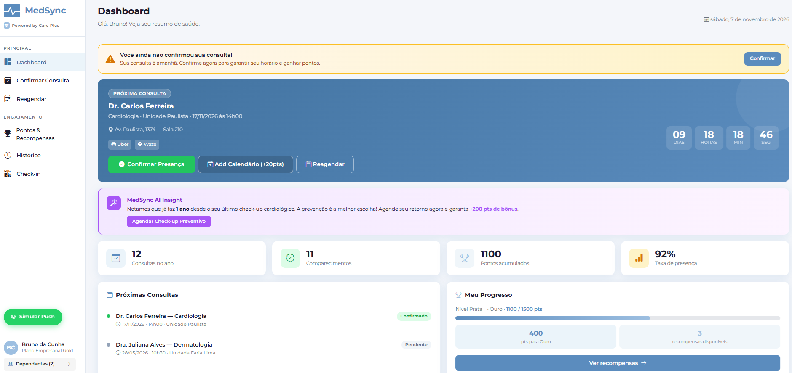
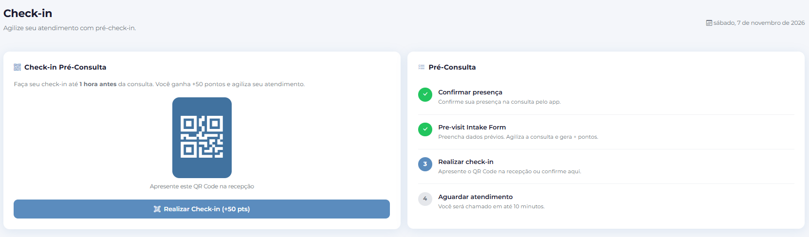
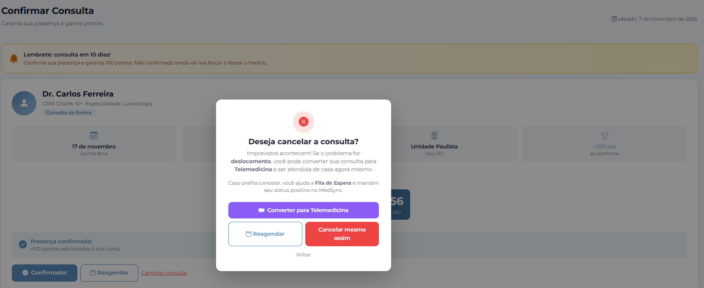
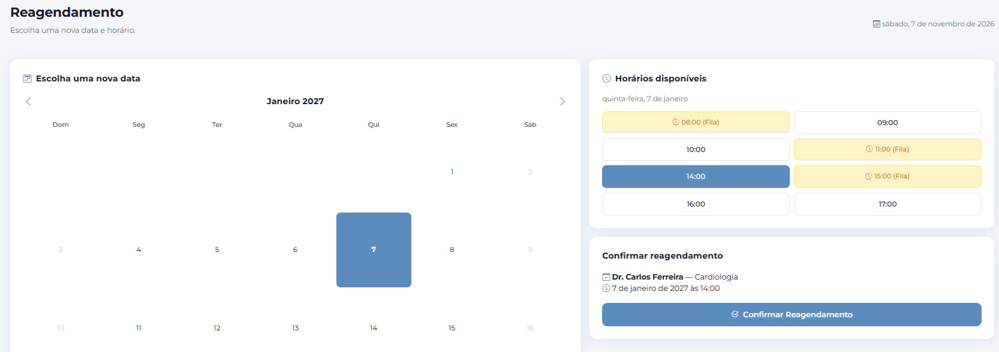
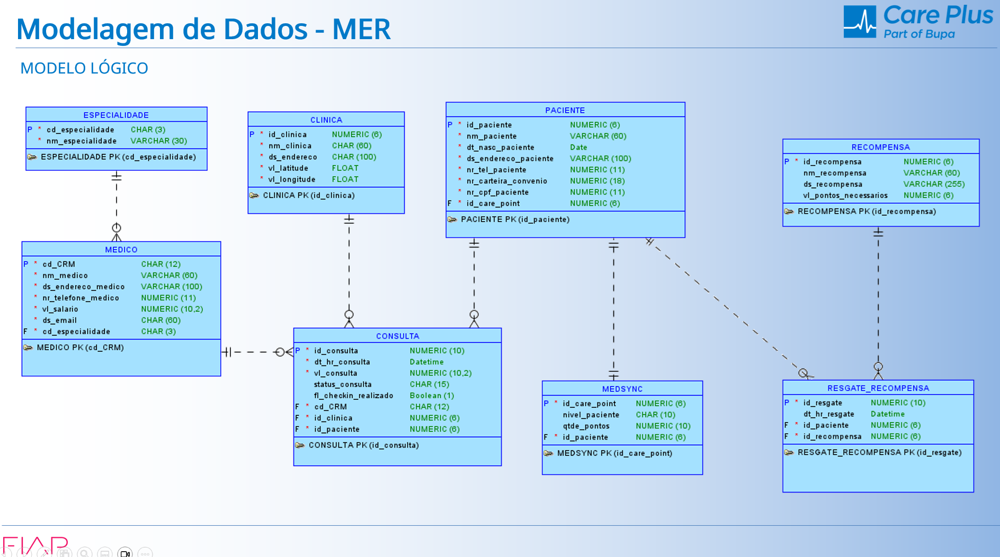
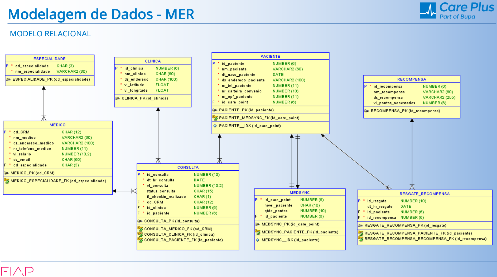

# 🚀 MedSync - Powered by Care Plus (FIAP Challenge)

**Visão Geral:** Uma solução digital inovadora desenvolvida para reduzir o *No-show* (não comparecimento) em clínicas, promovendo engajamento do paciente através de gamificação e otimizando a eficiência operacional da rede de saúde.

---

## 🎯 O Desafio de Negócio (O Problema)
O *no-show* gera impactos críticos na cadeia de saúde. O desafio foi criar um sistema que não apenas lembrasse o paciente, mas mudasse o seu comportamento e protegesse a receita da clínica, combatendo:
*   📉 Perda de produtividade médica.
*   💸 Aumento de custos operacionais.
*   ⚠️ Comprometimento da jornada de cuidado do paciente.

---

## 💡 A Solução e Arquitetura do Produto
O **MedSync** foi estruturado em duas camadas de atuação para garantir a saúde do negócio e o bem-estar dos pacientes:

### 👤 Camada 1: Core da Experiência (Centrada no Paciente)
*   🏆 **Gamificação Premium:** Sistema de pontos progressivo (Bronze, Prata, Ouro) e recompensas reais para pacientes assíduos.
*   ⏰ **Lembretes Inteligentes:** Abordagem multicanal e confirmação ativa com gatilhos de urgência (*Countdown timer*).
*   📅 **Reagendamento Fácil e Intuitivo:** Remarcação de consultas em poucos cliques com horários sugeridos, reduzindo o atrito na jornada.

### ⚙️ Camada 2: Estratégia de Negócio (Centrada na Operação)
*   🔄 **Waitlist Automation:** Preenchimento automático de vagas em caso de cancelamento.
*   🧠 **Saúde Preditiva (AI Insights):** Cruzamento de dados para sugerir check-ups preventivos.
*   📋 **Pre-visit Intake Form:** Formulários de check-in antecipado online, otimizando o fluxo na recepção.

---

## 🖥️ UX e Interface
A interface foi projetada focando em clareza visual, *frictionless* (zero atrito) e visão de dependentes (Hub de Saúde Familiar).

| Dashboard Principal | Tela de Check-in |
| :---: | :---: |
|  |  |
| **Confirmação de Ação** | **Reagendamento** |
|  |  |

---

## ⚙️ Arquitetura de Dados (Modelagem)
Para sustentar a operação e a gamificação, o banco de dados relacional foi modelado contemplando o ecossistema médico:

*   📄 **Tabelas Principais:** `PACIENTE`, `MEDICO`, `CLINICA`, `CONSULTA`.
*   🎮 **Motor de Gamificação:** Estruturação das entidades `MEDSYNC` (status de nível e pontos), `RECOMPENSA` e `RESGATE_RECOMPENSA` para rastreabilidade de benefícios.

*(Visualize os diagramas abaixo)*

**Modelo Lógico** 

**Modelo Relacional** 

---

## 🛠️ Tecnologias Utilizadas
*   **Modelagem de Dados:** Oracle SQL / Relacional
*   **Design/Prototipação:** Figma / UI Design
*   **Linguagens/Frameworks:** *(Liste aqui o que você usou de código: ex: Java Spring Boot, React, etc.)*
